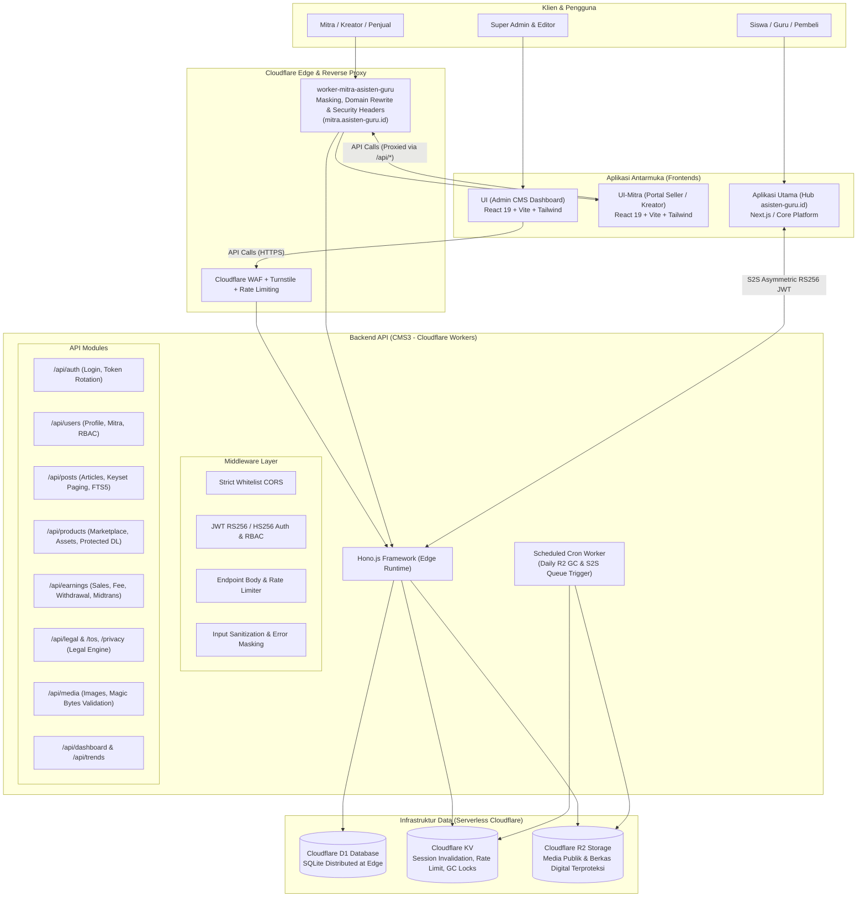

<p align="center">
  
</p>

<h1 align="center">Asisten Guru Headless CMS & Digital Marketplace Engine</h1>

<p align="center">
  
  
  
  
  
</p>

<p align="center">
  Platform Headless CMS dan Ekosistem Marketplace Produk Digital modern berkinerja tinggi, aman, dan dirancang khusus untuk skalabilitas tanpa batas menggunakan ekosistem Serverless Edge Cloudflare.
</p>

---

## 🚀 Ikhtisar Arsitektur Sistem

Asisten Guru CMS mengadopsi arsitektur **Headless API-First & Micro-Frontends** berbasis Serverless Edge Computing. Logika backend terisolasi penuh dari antarmuka visual, menghubungkan CMS administratif, portal mitra, dan platform ekosistem Hub utama (`asisten-guru.id`).



---

## 🛠️ Komponen Ekosistem Monorepo

Repositori ini dikelola sebagai monorepo berbasis pnpm workspace yang terdiri dari 4 komponen inti:

| Direktori | Komponen | Peran & Tanggung Jawab |
| :--- | :--- | :--- |
| `src/` | **Core Backend API (Cloudflare Worker)** | Endpoint REST API bertenaga Hono.js, validasi Zod, sanitasi DOMPurify, hashing bcrypt, RBAC dinamis, dan integrasi D1/R2/KV. Berjalan di `cms.asisten-guru.my.id`. |
| `UI/` | **Admin Dashboard CMS** | Panel administratif internal untuk Super Admin dan Editor konten (manajemen artikel, kurasi produk mitra, persetujuan penarikan dana, manajemen pengguna, dan audit log). |
| `UI-Mitra/` | **Portal Kreator & Seller** | Aplikasi web khusus mitra kreator untuk onboarding, studio kustomisasi profil toko (tampilan cover/avatar, etalase, foto kurasi sampel), manajemen produk digital, dan riwayat pendapatan (*earnings*). |
| `worker-mitra-asisten-guru/` | **Edge Reverse Proxy Worker** | Worker yang bertugas melakukan masking domain ke `mitra.asisten-guru.id`, menyajikan rute SPA fallback, meretrif rute statis legal (`/tos`, `/privacy`), rewrite domain cookie autentikasi, dan menyematkan security headers. |

---

## ✨ Fitur Unggulan Sistem

### 1. Marketplace Produk Digital & Etalase Seller Mandiri 🛍️
- **Manajemen Aset Digital Terproteksi:** File produk (ZIP/PDF/media materi edukasi) disimpan di Cloudflare R2 dengan kunci acak terisolasi. URL asli bucket R2 tidak pernah terekspos ke publik.
- **Toko & Profil Seller Komprehensif:** Kustomisasi profil toko (nama toko, slug unik, bio, cover etalase, foto portofolio kurasi, media sosial) serta sistem review terverifikasi pembeli.
- **Pengunduhan Terverifikasi (Protected Download):** Pengunduhan file produk hanya dapat dilakukan melalui otorisasi *token-grant* aman atau verifikasi S2S dari Hub setelah transaksi valid.

### 2. Integrasi Antar-Layanan Hub (S2S Asymmetric RS256) 🤝
- Hub utama (`asisten-guru.id`) bertindak sebagai penyedia checkout/pembayaran pengguna.
- Komunikasi backend-to-backend menggunakan enkripsi asimetris RS256 (`HUB_PUBLIC_KEY` & payload JWT berumur pendek 30–60 detik) untuk mencegah replikasi data, manipulasi harga (*price-lock*), dan otorisasi unduhan file digital secara aman.
- Mendukung sinkronisasi antrean berkala (*S2S sync-queue*) yang dipicu secara otomatis oleh Cron Worker CMS.

### 3. Keuangan & Penghasilan Kreator (Earnings & Withdrawals) 💰
- **Dynamic Fee Calculation:** Penghitungan komisi platform dinamis per transaksi penjualan produk.
- **Holding Period & Settlement:** Mekanisme penahanan saldo sementara untuk proteksi komplain/dispute sebelum dana masuk ke saldo yang dapat ditarik (*withdrawable*).
- **Manajemen Penarikan Dana:** Alur pencairan dana transparan lengkap dengan verifikasi rekening bank/e-wallet, audit status penarikan, dan pencatatan riwayat transaksi.

### 4. Performa Edge Ekstrem & Keamanan Zero-Trust ⚡🛡️
- **Ultra-Low Latency:** Dieksekusi langsung di Cloudflare Edge Network terdekat dengan klien (response time rata-rata 30–60ms).
- **SQLite FTS5 Full-Text Search:** Pencarian artikel dan materi berkecepatan tinggi tanpa dependensi mesin pencari pihak ketiga eksternal.
- **Paginasi Kursor (Keyset Pagination):** Menjamin performa query `O(1)` konsisten bahkan pada jutaan baris data, menghindari degradasi `OFFSET` klasik.
- **Zero Technical Error Leakage:** Middleware global menyaring seluruh error database/sistem dan menyajikan pesan ramah pengguna berbahasa Indonesia ke klien.

### 5. Mesin Dokumen Legal & SEO Terintegrasi 📄📈
- **Legal Document Engine:** Rute `/tos` dan `/privacy` dirender langsung dari database D1 menjadi halaman HTML statis ramah crawler dan bot mesin pencari dengan canonical link yang tepat.
- **Automated Sitemap XML:** Generator sitemap dinamis bertingkat untuk artikel dan katalog marketplace dengan pemisahan status draft/terbit.
- **Client-Side Image Optimization:** Reduksi ukuran gambar via HTML5 Canvas sebelum transmisi untuk efisiensi transfer data dan kuota R2.
- **Garbage Collector R2 Otomatis:** Cron job harian yang membersihkan berkas orphan pada jam non-sibuk (03:00 WIB) untuk menghemat biaya penyimpanan.

---

## 📂 Struktur Repositori Terpadu

```text
├── src/                               # BACKEND API (Cloudflare Workers)
│   ├── index.ts                       # Entry point, Global Middleware (CORS, CSP, BodyLimit, Cron)
│   ├── types.ts                       # Definisi TypeScript Bindings & JWT Types
│   ├── routes/                        # Modul Rute REST API
│   │   ├── auth.ts                    # Login, refresh token rotation, logout, reset password
│   │   ├── users.ts                   # Manajemen user, profil seller, avatar/cover, RBAC
│   │   ├── products.ts                # Marketplace, public catalog, protected download, upload file
│   │   ├── earnings.ts                # Pencatatan penjualan, fee dinamis, mutasi, penarikan dana
│   │   ├── posts.ts                   # Artikel blog, FTS5 search, keyset pagination
│   │   ├── categories.ts              # Kategori bertingkat untuk artikel & produk
│   │   ├── tags.ts                    # Tag artikel
│   │   ├── media.ts                   # Upload media gambar umum ke R2 (magic bytes validation)
│   │   ├── legal.ts                   # CRUD dokumen legal & HTML renderer
│   │   ├── dashboard.ts               # Statistik analitik performa artikel & seller
│   │   ├── trends.ts                  # Rekomendasi tren topik konten
│   │   ├── settings.ts                # Pengaturan konfigurasi sistem global
│   │   └── seo.ts                     # Sitemap XML generator & robots.txt
│   ├── middlewares/                   # Layer Middleware Keamanan
│   │   ├── auth.ts                    # JWT verification & RBAC check
│   │   ├── error-handler.ts           # Sanitasi error teknis (anti-leakage)
│   │   └── rate-limit.ts              # Rate limiter berbasis IP & KV
│   └── utils/                         # Fungsi Utilitas Sistem
│       ├── garbage-collector.ts       # Cron R2 orphan files cleaner
│       ├── hub-jwt.ts                 # Validasi JWT RS256 S2S dari Hub
│       ├── malware-scanner.ts         # Pemeriksaan berkas berbahaya sebelum upload R2
│       ├── legal-html-template.ts     # Template HTML responsif dokumen legal
│       └── sanitize.ts                # Sanitasi input HTML DOMPurify
├── UI/                                # FRONTEND ADMIN DASHBOARD (React 19 + Vite)
│   ├── src/components/                # Komponen antarmuka admin, kurasi produk, manajemen seller
│   └── vite.config.ts                 # Konfigurasi bundler Admin UI
├── UI-Mitra/                          # PORTAL MITRA / SELLER (React 19 + Vite)
│   ├── src/components/                # Komponen antarmuka etalase, studio profil, produk mitra
│   └── vite.config.ts                 # Konfigurasi bundler Portal Mitra
├── worker-mitra-asisten-guru/         # EDGE PROXY WORKER
│   ├── src/index.ts                   # Reverse proxy, cookie domain rewrite, routing SPA
│   └── wrangler.jsonc                 # Binding Worker Proxy untuk mitra.asisten-guru.id
├── migrasi/                           # SKEMA & ARSIP MIGRASI DATABASE (Cloudflare D1)
│   ├── schema.sql                     # Skema dasar database utama
│   └── migration_*.sql                # File migrasi penambahan fitur inkremental
├── docs/                              # DOKUMENTASI TEKNIS & INTEGRASI
│   ├── endpointdoc.md                 # Dokumentasi endpoint API lengkap & proteksi
│   └── hub_integration_guide.md       # Panduan integrasi S2S aplikasi Hub
├── wrangler.jsonc                     # Konfigurasi Cloudflare Workers Backend Utama
├── Agents.md                          # Panduan Ketat & Batasan Operasional AI Coding Agent
└── README.md                          # Panduan Arsitektur & Operasional Sistem
```

---

## 🛠️ Panduan Pengembangan Lokal (Local Development)

### Prasyarat
- Node.js versi 20+ & pnpm
- Cloudflare Wrangler CLI (`npm install -g wrangler` atau via npx)

### 1. Menjalankan Backend API (Local Edge Simulator)
API backend berjalan pada edge environment lokal menggunakan SQLite simulasi:

1. Salin berkas lingkungan lokal:
   ```bash
   cp .dev.vars.example .dev.vars
   ```
2. Isi nilai rahasia di `.dev.vars` (jangan pernah di-commit ke Git):
   ```env
   JWT_SECRET="kunci-rahasia-jwt-lokal-yang-panjang-dan-acak"
   SUPER_ADMIN_EMAIL="admin@asisten-guru.id"
   SUPER_ADMIN_PASSWORD_HASH="$2a$10$contoh_hash_bcrypt_superadmin"
   ALLOWED_ORIGINS="http://localhost:3000,http://localhost:5173,http://localhost:5174"
   ```
3. Inisialisasi skema database lokal:
   ```bash
   npx wrangler d1 execute cms-db --local --file=./migrasi/schema.sql
   ```
4. Jalankan backend:
   ```bash
   npm run dev
   ```
   *(Backend aktif di `http://localhost:8787`)*

### 2. Menjalankan Admin UI & UI-Mitra
Buka terminal terpisah untuk masing-masing aplikasi frontend:

```bash
# Menjalankan Admin Dashboard UI
cd UI
npm install
npm run dev # Berjalan di http://localhost:3000

# Menjalankan Portal Mitra UI
cd ../UI-Mitra
npm install
npm run dev # Berjalan di http://localhost:5174
```

---

## 🚢 Panduan Deployment ke Lingkungan Produksi

> [!IMPORTANT]
> **Aplikasi ini telah LIVE dan melayani pengguna aktif.** Seluruh deployment harus dilakukan secara terukur tanpa menimbulkan downtime atau data corruption.

### 1. Deploy Backend Worker (`cms3`)
```bash
# Terapkan migrasi skema inkremental jika ada perubahan tabel (SELALU BACKWARD-COMPATIBLE)
npx wrangler d1 execute cms-db --remote --file=./migrasi/<nama_migrasi_baru>.sql

# Atur atau perbarui secrets secara aman melalui CLI (Bukan di file kode)
npx wrangler secret put JWT_SECRET
npx wrangler secret put S2S_INTERNAL_SECRET
npx wrangler secret put TURNSTILE_SECRET

# Deploy Worker ke Edge Network
npm run deploy
```

### 2. Deploy Frontends (Cloudflare Pages)
```bash
# Deploy Admin Dashboard
cd UI
npm run build
npx wrangler pages deploy dist --project-name cms-ui

# Deploy Portal Mitra
cd ../UI-Mitra
npm run build
npx wrangler pages deploy dist --project-name ui-mitra
```

### 3. Deploy Edge Reverse Proxy
```bash
cd worker-mitra-asisten-guru
npx wrangler deploy
```

---

## 🔒 Kebijakan Keamanan & Kepatuhan Data

- **Pencegahan Kebocoran Kredensial:** Repositori ini bersifat **Public Open-Source**. Seluruh token, private key, secret, dan kredensial akun dilarang keras masuk ke dalam riwayat commit Git.
- **Isolasi Error Sistem:** Tidak ada pesan error SQL (`D1_ERROR`, `SQLite exception`), stack trace, atau detail backend yang diteruskan ke klien.
- **Validasi Integritas Berkas:** Seluruh berkas media dan berkas produk diverifikasi melalui inspeksi *magic bytes* dan pemindaian MIME type untuk mencegah eksekusi kode berbahaya (*malicious executable upload*).
- **Anti-IDOR:** Seluruh endpoint yang mengubah profil, produk, atau data finansial wajib memverifikasi identitas pemilik berdasarkan `user.id` token yang terotentikasi.

---

## 📄 Lisensi

Proyek ini dirilis di bawah naungan lisensi **[MIT License](./LICENSE)**.
Dibuat dengan dedikasi untuk mendukung kemandirian guru, kreator, dan pendidikan berkualitas.
